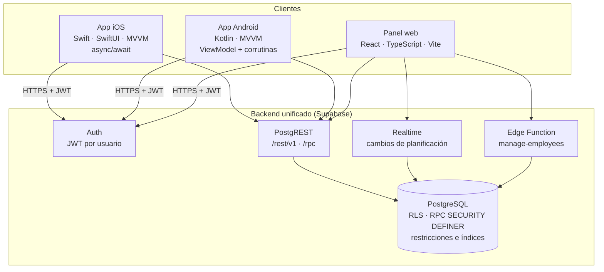
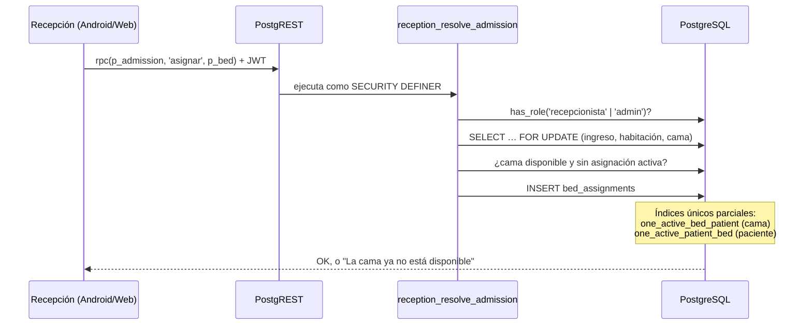
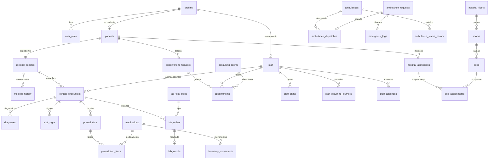

# Documento de arquitectura — Hospital Universitario

Proyecto final de *Desarrollo de Aplicaciones Móviles Avanzadas*. Este documento cubre los entregables técnicos del enunciado (sección 4): diagrama de arquitectura, modelo de datos, matriz de control de acceso por rol (RBAC) y política de privacidad.

> Todo lo descrito aquí se verificó contra la base de datos desplegada (*Hospital Móviles*) el 20 de noviembre de 2026: las políticas RLS se leyeron de `pg_policies` y los permisos de las funciones, de `pg_proc`.

| Repositorio | Plataforma | Usuarios |
|---|---|---|
| `Hospital-Universitario` | iOS (Swift, SwiftUI) | Doctores y pacientes |
| `Android` | Android (Kotlin, XML + ViewBinding) | Recepción, enfermería y doctores |
| `AdminHospital` | Web (React 19, TypeScript, Vite) | Administración y jefes de operaciones |
| `AdminHospital/supabase` y `Hospital-Universitario/supabase` | Backend (Supabase) | Compartido por los tres clientes |

**Enlace al prototipo en Figma:** _TODO: pegar aquí el enlace al prototipo y al sistema de diseño._

---

## 1. Arquitectura de software

### 1.1 Vista general

- **Un solo backend.** Los tres clientes usan el mismo proyecto Supabase, con la URL y la **clave publishable**. Ningún cliente tiene la clave `service_role`. La única operación que la necesita, crear cuentas de empleados, la hace la Edge Function `manage-employees` en el servidor, después de comprobar que quien la llama es administrador.
- **Las reglas viven en la base de datos.** Validaciones, transiciones de estado y control de concurrencia están en funciones SQL (RPC) y en restricciones. Así ningún cliente puede saltárselas, aunque llame a la API directamente.
- **Dos formas de acceso:**
  1. **Lectura directa de tablas**, protegida por *Row Level Security*: catálogos, avisos y datos propios.
  2. **Funciones RPC `SECURITY DEFINER`** para los flujos con reglas de negocio: asignar cama, despachar ambulancia, cerrar una consulta o publicar un resultado. Cada función comprueba al empezar el rol y la relación con el paciente (`private.has_role`, `private.native_doctor_id`, `private.my_patient`, etc.) y rechaza con `42501` si no corresponde.
- **El rol nunca viene del cliente.** Se lee de `public.user_roles` (y está activo). No se usa `user_metadata`, porque el usuario puede modificarlo.

### 1.2 Arquitectura de cada cliente

| Capa | iOS | Android | Web |
|---|---|---|---|
| Vista | SwiftUI (`ContentView`, `Doctor/*`, `Patient/*`) | Activities con ViewBinding | Páginas React (`src/pages`) |
| Estado / ViewModel | `HospitalStore`, `DoctorViewModel`, `MobileModuleViewModel` (`ObservableObject`, `@Published`) | `LoginViewModel` (`StateFlow`), `ReceptionDeskViewModel` y `DoctorNativeViewModel` sobre la base `OperationViewModel` | Estado de los componentes con *hooks* |
| Datos | `HospitalAPI`, `DoctorRepository`, `MobileModuleRepository` | Interfaces `*Repository`, con implementaciones Supabase creadas en `AppContainer` | Módulos de `src/lib` (`reception.ts`, `hospitalization.ts`, `transport.ts`…) |
| Asincronía | `async/await` (`Task`) | Corrutinas: `viewModelScope` y `Dispatchers.IO`; la vista observa con `repeatOnLifecycle` | `Promise` y `async/await`; Realtime para planificación |

En Android, `OperationViewModel` deja correr **una sola operación a la vez** y comprueba que el rol de la sesión no haya cambiado. Así se evitan los dobles envíos, por ejemplo asignar la misma cama o cerrar la misma consulta dos veces.

### 1.3 Flujo de ejemplo: asignar una cama

Si dos recepcionistas eligen la misma cama a la vez, el `FOR UPDATE` hace que la segunda transacción espere a la primera y después vea la cama ocupada. Aunque fallara el bloqueo, los índices únicos impiden guardar la doble asignación.

---

## 2. Modelo de datos

### 2.1 Diagrama entidad-relación (entidades principales)

### 2.2 Entidades por módulo

| Módulo | Tablas | Campos y reglas clave |
|---|---|---|
| Identidad y roles | `profiles`, `user_roles`, `staff`, `patients` | Enum `hospital_role`: `admin`, `doctor`, `recepcionista`, `enfermera`, `paciente`. `staff.category` distingue doctor, enfermería, asistente, emergencia, etc. |
| Habitaciones | `hospital_floors`, `rooms`, `beds`, `hospital_admissions`, `bed_assignments`, `bed_status_history` | `rooms.kind`: `vip` (3ª planta, VIP-301 a VIP-305, 1 cama) o `semiprivada` (2ª planta, HAB-201 a HAB-206, camas A y B). En total 17 camas. Estados de cama: `disponible`, `ocupada`, `limpieza`, `mantenimiento`. Hay **un solo ingreso activo por paciente** y **una sola asignación activa por cama y por paciente** (índices únicos parciales). El catálogo de habitaciones y camas se deja abierto para una futura expansión. |
| Turnos del personal | `staff_shifts`, `staff_recurring_journeys`, `staff_absences`, `doctor_schedules`, `consulting_rooms`, `doctor_consulting_rooms` | `EXCLUDE USING gist` impide turnos solapados de una misma persona y la doble reserva de un consultorio. |
| Citas | `appointment_requests`, `appointments`, `appointment_status_history` | Estados: `programada`, `confirmada`, `en_atencion`, `completada`, `cancelada`, `no_asistio`. Sin solapes por doctor, consultorio ni paciente (`EXCLUDE`). |
| Consulta general | `medical_records`, `clinical_encounters`, `diagnoses`, `vital_signs`, `medical_history`, `prescriptions`, `prescription_items` | La consulta (SOAP) solo la edita el doctor autor. El paciente la ve cuando está cerrada (`ended_at`). |
| Laboratorio | `lab_test_types`, `lab_orders`, `lab_results`, `lab_result_files`, `lab_delivery_events` | `lab_orders.status`: **`pendiente` → `en_proceso` → `completado`**. El resultado se valida (`validated_by`, `validated_at`) y se publica al paciente (`published_to_patient_at`). |
| Inventario | `medications`, `inventory_movements`, `prescription_dispenses` | `stock >= 0` y `minimum_stock`. La dispensación descuenta stock y registra el movimiento. |
| Ambulancia | `ambulances`, `ambulance_requests`, `ambulance_dispatches`, `ambulance_status_history`, `emergency_logs` | Estados de la unidad: **`disponible`, `en_servicio`, `en_mantenimiento`**. Solicitud: `pendiente`, `autorizada`, `despachada`, `finalizada`, `rechazada`, `cancelada`. **Un solo despacho activo por unidad** (`only_one_active_dispatch`) y por conductor. La bitácora (`emergency_logs`) se filtra por estado en `panel_transport_data`. |
| Avisos | `announcements`, `notifications` | Los avisos con `is_public` son visibles sin iniciar sesión. Las notificaciones son personales (`recipient_id`). |
| Auditoría | `audit_logs` | Cambios de flota, conductores y otros, con actor y valores anteriores y nuevos. |

---

## 3. Matriz de control de acceso por rol (RBAC)

Leyenda: **L** = leer · **E** = escribir o modificar · **—** = sin acceso · **propio** = solo los registros del propio usuario · **tratante** = el doctor con atención vigente para ese paciente (equipo de atención, consulta propia, o cita propia en curso o dentro de ±24 h).

### 3.1 Vistas por plataforma

| Plataforma / módulo | Admin | Doctor | Recepción | Enfermería | Paciente |
|---|---|---|---|---|---|
| **Web:** dashboard, personal, turnos, habitaciones, ambulancia, inventario, laboratorio, reportes | ✔ | — | ✔ Recepción, hospitalización, ambulancia | — | — |
| **Web:** panel de laboratorio | ✔ | — | — | — | — |
| **Android:** Recepción (solicitudes, agenda, presencial, pacientes, hospitalización) | — | — | ✔ | — | — |
| **Android:** Doctor nativo (agenda, consulta, pacientes, expediente) | — | ✔ | — | — | — |
| **Android:** Enfermería | — | — | — | ✔ (*datos de demostración*) | — |
| **iOS:** Doctor (agenda, consulta, recetas, laboratorio, expedientes, horario) | — | ✔ | — | — | — |
| **iOS:** Paciente (citas, solicitudes, historial, recetas, laboratorio, hospitalización, avisos) | — | — | — | — | ✔ |

El panel web también admite al **personal de laboratorio** autorizado (`laboratory_authorizations`), que solo ve el panel de laboratorio (`AdminGate.tsx`).

Cada cliente comprueba el rol al iniciar sesión. Android, por ejemplo, rechaza a quien no tenga el rol de la pantalla (`SessionManager.currentRole`). Pero **la autorización efectiva la hace el servidor**: aunque se manipule el cliente, RLS y las RPC rechazan el acceso.

### 3.2 Datos (tablas con RLS)

| Recurso | Admin | Doctor | Recepción | Enfermería | Paciente | Anónimo |
|---|---|---|---|---|---|---|
| Plantas, habitaciones y camas (estado) | L/E (RPC) | L | L | L | L | L |
| Avisos públicos | L/E | L | L | L | L | L |
| Especialidades, síntomas, tipos de examen | L/E | L | L | L | L | L |
| Personal (`staff`) | L/E | L | L | L | L | — |
| Turnos y ausencias | L/E | L propio | L horarios de doctores | L propio | — | — |
| Pacientes (datos personales) | L/E | L con cita o consulta suya¹ | L/E | L asignado | L propio | — |
| Expediente (`medical_records`) | L | L con cita o consulta suya¹ | L (identificación, sin contenido clínico) | L asignado | L propio | — |
| Antecedentes (`medical_history`) | L | L/E tratante | **—** | L/E asignado | L propio | — |
| Consultas y diagnósticos | — | L/E autor | — | — | L propio, ya cerradas | — |
| Signos vitales | — | L/E autor o tratante | — | L/E asignado | L propio, ya cerradas | — |
| Recetas | L | L/E autor o tratante | — | — | L propio | — |
| Órdenes de laboratorio | L | E autor · L tratante | **—** | — | L propio | — |
| Resultados de laboratorio | L vía RPC `laboratory_panel`; el personal de laboratorio, L/E | L tratante (validados) | — | — | L propio (publicados) | — |
| Citas y solicitudes | L | L tratante | L/E (RPC) | — | L/E propio | — |
| Ingresos y asignación de cama | L/E | L tratante · solicita ingreso y alta | L/E (asignar, liberar, trasladar) | L asignado | L propio | — |
| Ambulancia: unidades | L/E | L | L | L | L | — |
| Ambulancia: solicitudes y despachos | L/E | L/E sus pacientes | L/E | — | L/E propio | — |
| Bitácora y estados de la ambulancia | L | — | L bitácora | — | — | — |
| Medicamentos e inventario | L/E | L | L | L | L | — |
| Auditoría | L | — | — | — | — | — |

*Personal de laboratorio:* empleados con permiso en `laboratory_authorizations` (`private.lab_permission`).

¹ `private.treats_patient`: el doctor tiene con ese paciente una cita (programada, confirmada, en atención o completada), una consulta propia o una asignación vigente en el equipo de atención. Para el **contenido clínico** se usa la regla más estricta `private.doctor_care_access`, sin citas lejanas en el tiempo.

### 3.3 Endpoints RPC por rol

| Rol | Funciones (`/rest/v1/rpc/…`) |
|---|---|
| **Admin** | `save_hospital_room`, `save_hospital_bed`, `set_bed_state`, `save_panel_ambulance`, `authorize_panel_driver`, `review_medical_transport`, `assign_medical_transport`, `dispatch_ambulance`, `add_inventory`, `dispense_item`, `save_staff_planning`, `save_staff_planning_set`, `save_recurring_journey*`, `read_staff_schedule`, `upsert_staff`, `set_employee_role`, `save_hospital_settings`, `laboratory_panel`, `authorize_laboratory_staff` y la Edge Function `manage-employees` |
| **Admin y Recepción** | `reception_*` (agenda, ingresos, inventario de camas, disponibilidad, resolución), `assign_bed`, `release_bed`, `transfer_bed`, `complete_hospital_bed_cleaning`, `schedule_appointment`, `cancel_appointment`, `update_appointment_status`, `review_attention_request`, `create_walkin_patient`, `request_medical_transport`, `panel_transport_data` |
| **Doctor** | `doctor_native_*` (workspace, chart, start, save, finish, lab, labs, prescribe, patients, alerts, admissions…), `request_admission`, `medical_discharge`, `doctor_save_admission_assessment`, `doctor_decide_admission_assessment` |
| **Laboratorio** | `start_laboratory_order`, `save_laboratory_draft`, `complete_laboratory_exam`, `submit_laboratory_validation`, `validate_laboratory_result`, `publish_lab_result`, `publish_laboratory_order`, `correct_laboratory_result` |
| **Paciente** | `register_patient`, `submit_my_attention_request`, `my_attention_requests`, `my_attention_context`, `my_consultation_history`, `my_hospitalizations` |
| **Conductor autorizado** | `progress_medical_transport`, `finish_medical_transport`, `complete_dispatch` (solo sobre su propio despacho) |

El usuario anónimo (`anon`) **no puede ejecutar ninguna función `SECURITY DEFINER`**: se verificó en `pg_proc` con `has_function_privilege`.

---

## 4. Política de privacidad de datos

### 4.1 Clasificación de la información

| Categoría | Datos | Quién accede |
|---|---|---|
| **Pública** | Ocupación general por planta (estado de habitaciones y camas, sin pacientes), avisos generales publicados y vigentes, catálogo de especialidades y exámenes | Cualquiera, incluso sin iniciar sesión (políticas `TO anon, authenticated`) |
| **Interna** | Personal y médicos de turno, consultorios, estado de la ambulancia, catálogo de medicamentos | Usuarios con sesión iniciada |
| **Privada / sensible** | Expediente médico, antecedentes, consultas, diagnósticos, signos vitales, recetas, órdenes y resultados de laboratorio, **habitación y cama asignadas**, datos personales (DUI, teléfono, fecha de nacimiento, ciudad, correo) | Solo el **paciente**, el **médico tratante**, la **enfermería asignada** y la **administración autorizada**, según la matriz del apartado 3.2 |

### 4.2 Campos del expediente: públicos y privados

| Entidad | Campos públicos | Campos privados |
|---|---|---|
| `beds` / `rooms` | `code`, `state`, `kind`, `floor_id`, `active` | — (la cama no guarda qué paciente la ocupa) |
| `bed_assignments` | — | `patient_id`, `bed_id`, `admission_id`, fechas |
| `patients` | — | Todos: `first_name`, `last_name`, `dui`, `phone`, `birth_date`, `city`, `email`, `patient_code` |
| `medical_records` | — | `record_code`, `opened_at` (recepción solo los usa para identificar y preparar el expediente) |
| `medical_history`, `clinical_encounters`, `diagnoses`, `vital_signs` | — | Todos |
| `prescriptions`, `prescription_items` | — | Todos |
| `lab_orders`, `lab_results` | — | Todos. El paciente solo ve el resultado validado y publicado. |
| `staff` | `employee_code`, `category`, `active` (internos) | Los datos personales están en `profiles`, que solo ven el propio usuario y la administración |
| `announcements` | `title`, `content`, `published_at`, `expires_at` cuando `is_public` | Avisos no públicos o vencidos |

### 4.3 Medidas técnicas

1. **RLS activo en todas las tablas públicas**, con políticas por rol y por relación con el paciente (`my_patient`, `doctor_care_access`, `cares_for`, `encounter_doctor`).
2. **Principio de mínimo privilegio para recepción:** gestiona identidad, citas y camas, pero **no ve** antecedentes, órdenes ni resultados de laboratorio (política `rls_privacidad_clinica`, aplicada el 20 de noviembre de 2026).
3. **Acceso del médico limitado en el tiempo:** solo con una relación asistencial vigente. Tener una cita futura cualquiera ya no basta.
4. **El paciente ve su información clínica cuando el acto ha terminado:** consulta cerrada, resultado validado y publicado.
5. **Sin secretos en los clientes:** solo la clave publishable. Las operaciones privilegiadas se hacen en el servidor (Edge Function o RPC).
6. **Protección en el dispositivo:** las pantallas clínicas de Android usan `FLAG_SECURE`, que bloquea capturas y la vista previa en *multitarea*.
7. **Trazabilidad:** `audit_logs`, `appointment_status_history`, `bed_status_history`, `ambulance_status_history` y `emergency_logs` registran quién cambió qué y cuándo.

---

## 5. Limitaciones conocidas

| Tema | Estado |
|---|---|
| Médicos de turno como información pública | Hoy solo los ven usuarios con sesión (`staff` y turnos). Para mostrarlos sin sesión haría falta una vista pública con nombre y especialidad. |
| Enfermería en Android | Las pantallas existen, pero usan datos de demostración en memoria (`FakeEntryRepository`). |
| Flota de ambulancias | El enunciado describe una sola unidad, y en la base hay una registrada (AMB-001). El sistema permite registrar más para una futura expansión. Un mismo vehículo no puede tener dos servicios activos. |
| Inventario de insumos | El inventario cubre medicamentos (stock y mínimo). Los insumos generales (por ejemplo, guantes) no tienen todavía su propia tabla. |
